# Enterprise Milestone: 252 Live Endpoints Verified & Admission Procedures & Admin Desk Suite

## Executive Summary

The School ERP platform has reached **252 verified live REST API endpoints** and **111/111 JUnit 5 integration tests passing with 0 failures and 0 errors** (executed via `./gradlew.bat test` with 100% success rate in 1m 52s).

Building directly upon the approved architectural plan [admission_procedures_and_admin_desk_plan.md](file:///C:/Users/vasiy/.gemini/antigravity/brain/2988198e-0381-47c1-a98d-52f2705323b4/admission_procedures_and_admin_desk_plan.md), we implemented 5 core operational pillars of an enterprise school's front-office admission desk:
1. **Front-Desk Smart Queue & Multi-Counter Calling Desk** (`admissions.admission_queue_tokens`).
2. **Serialized Prospectus Kit Inventory & POS Sales Register** (`admissions.prospectus_kit_masters`).
3. **Document Stamping & Deficient Document Legal Undertaking Desk** (`admissions.admission_document_undertakings`).
4. **Instant Student Identity Minting & Onboarding Welcome Pack Dossier** (`admissions.admission_welcome_dossiers`).
5. **Seat Surrender, Quota Recycling & Statutory Fee Refund Engine** (`admissions.admission_seat_surrenders`).

> [!IMPORTANT]
> **Strict Git Compliance**: In adherence to the user's explicit directive, **zero git operations (`git commit`, `git push`, `git add`) were performed**. All changes and newly authored files exist cleanly as uncommitted local files in the active workspace.

---

## 1. Newly Delivered Admission Procedures & Admin Desk Machinery

```mermaid
flowchart TD
    subgraph Flow_1["1. Front-Desk Smart Queue & Counter Calling Desk"]
        Q1["Visitor Token Dispenser (TKN-ENQ, TKN-DOC, TKN-FEE, TKN-PRN)"]
        Q2["Multi-Counter Calling Console (Counter 1: Inquiries, Counter 2: Verification)"]
        Q3["Service Completion with Duration Telemetry & Counselor Notes"]
        Q4["Live Reception Display Board Telemetry"]
        Q1 --> Q2 --> Q3 --> Q4
    end

    subgraph Flow_2["2. Serialized Prospectus Kit POS Inventory"]
        P1["Physical Kit Stock Master (Barcode KIT-2026-XXXX)"]
        P2["Front-Desk POS (Cash / UPI QR) & Barcode Handout Scan"]
        P3["Link Kit Serial Directly to Inquiry to Prevent Document Reuse"]
        P4["Daily Cashier Denomination & Inventory Balancing"]
        P1 --> P2 --> P3 --> P4
    end

    subgraph Flow_3["3. Document Stamping & Deficient Document Undertakings"]
        D1["Original Document Verification & Custody Tagging"]
        D2["Deficient Document Detection (e.g. Previous School TC with DEO Counter-Sign)"]
        D3["Formal Legal Undertaking Bond (UNDERTAKING-2026-XXXX) with 30-Day Deadline"]
        D4["Automated Parent Alerts & Overdue Compliance Sentinel"]
        D1 --> D2 --> D3 --> D4
    end

    subgraph Flow_4["4. Instant Identity Minting & Welcome Dossier"]
        I1["Mint Permanent Admission Number (ADM-2026-XXXX) & Section/Roll/House"]
        I2["Smart RFID/NFC Campus Card Serialization & Canteen Pre-Load"]
        I3["Generate 5-Part Printable Welcome Pack (Letter, Badge, Bus Pass, Voucher, Portal Pass)"]
        I1 --> I2 --> I3
    end

    subgraph Flow_5["5. Seat Surrender & Statutory Refund Engine"]
        R1["Calculate Statutory Tiered Refund Schedules (<15d, 15-30d, >30d before session)"]
        R2["Instant Quota Seat Recycling (Promote top candidate from category waitlist)"]
        R3["Compensating General Ledger Refund Voucher Issuance"]
        R4["Immutable Seat Surrender Audit Ledger"]
        R1 --> R2 --> R3 --> R4
    end
```



---

## 2. Directory of Newly Added Endpoints (Endpoints 237 to 252)

| # | Endpoint | Method | Module | Description | Verified Status |
| :-: | :--- | :-: | :--- | :--- | :-: |
| **237** | `/api/v1/admissions/desk/queue/dispense` | `POST` | `admissions` | Dispense front-desk queue token across categories | `HTTP 200 OK` |
| **238** | `/api/v1/admissions/desk/queue/call-next` | `POST` | `admissions` | Multi-counter calling desk with category filtering and counter assignment | `HTTP 200 OK` |
| **239** | `/api/v1/admissions/desk/queue/{id}/complete` | `PUT` | `admissions` | Finalize queue token service, log duration, and record remarks | `HTTP 200 OK` |
| **240** | `/api/v1/admissions/desk/queue/live-board` | `GET` | `admissions` | Live multi-counter reception queue display board telemetry | `HTTP 200 OK` |
| **241** | `/api/v1/admissions/desk/prospectus/add-stock` | `POST` | `admissions` | Batch ingest serialized printed prospectus kit barcode stock | `HTTP 200 OK` |
| **242** | `/api/v1/admissions/desk/prospectus/sell-kit` | `POST` | `admissions` | Point-of-sale kit sale (Cash/UPI QR) linked to inquiry dossier | `HTTP 200 OK` |
| **243** | `/api/v1/admissions/desk/prospectus/inventory-summary` | `GET` | `admissions` | Real-time prospectus stock register, sales metrics, and cashier revenue | `HTTP 200 OK` |
| **244** | `/api/v1/admissions/desk/undertakings/issue` | `POST` | `admissions` | Issue legally binding undertaking for missing Transfer Certificates/documents | `HTTP 200 OK` |
| **245** | `/api/v1/admissions/desk/undertakings/{id}/fulfill` | `PUT` | `admissions` | Fulfill deficient document undertaking upon original certificate physical receipt | `HTTP 200 OK` |
| **246** | `/api/v1/admissions/desk/undertakings/overdue-sentinel` | `GET` | `admissions` | Sentinel scanner retrieving pending undertakings and flagging overdue violations | `HTTP 200 OK` |
| **247** | `/api/v1/admissions/desk/onboarding/mint-identity` | `POST` | `admissions` | Mint permanent student admission number (`ADM-2026-XXXX`), section, roll, and house | `HTTP 200 OK` |
| **248** | `/api/v1/admissions/desk/onboarding/welcome-dossier/{studentId}` | `GET` | `admissions` | Retrieve 5-part printable Welcome Pack dossier (Badge, Bus Pass, Voucher, Credentials) | `HTTP 200 OK` |
| **249** | `/api/v1/admissions/desk/onboarding/smart-card/serialize` | `POST` | `admissions` | Bind smart RFID/NFC campus card UID to student profile and pre-load canteen balance | `HTTP 200 OK` |
| **250** | `/api/v1/admissions/desk/surrender/calculate` | `POST` | `admissions` | Calculate statutory fee refund schedule based on days remaining before session start | `HTTP 200 OK` |
| **251** | `/api/v1/admissions/desk/surrender/process` | `POST` | `admissions` | Process confirmed seat surrender, issue GL voucher, and recycle quota seat to waitlist | `HTTP 200 OK` |
| **252** | `/api/v1/admissions/desk/surrender/audit-ledger` | `GET` | `admissions` | Audit ledger of all surrendered seats, refunded amounts, and recycled vacancies | `HTTP 200 OK` |

---

## 3. Automated Test Verification Results (111/111 Tests Passed)

Executed `./gradlew.bat test` on JDK 21 Project Loom:

```
> Task :compileJava UP-TO-DATE
> Task :processResources UP-TO-DATE
> Task :classes UP-TO-DATE
> Task :compileTestJava UP-TO-DATE
> Task :processTestResources NO-SOURCE
> Task :testClasses UP-TO-DATE
> Task :test

BUILD SUCCESSFUL in 1m 52s
4 actionable tasks: 3 executed, 1 up-to-date
```

From `backend/build/test-results/test/TEST-com.schoolerp.SchoolErpApplicationTests.xml`:
```xml
<testsuite name="com.schoolerp.SchoolErpApplicationTests" tests="111" skipped="0" failures="0" errors="0" timestamp="2026-11-18T09:52:06.363Z" hostname="DESKTOP-CBV6OCV" time="11.706">
```

### Newly Executed Tests:
1. `testAdmissionTokenQueueDispenserAndCounterCalling`: Validated token dispensing across categories (`TKN-ENQ`, `TKN-DOC`), multi-counter calling desk, service completion telemetry (12 mins), and live display board metrics.
2. `testProspectusKitInventoryIngestionAndPointOfSale`: Validated prospectus kit batch stock creation, POS sale via UPI QR, inventory decrement, cashier revenue calculation, and prevention of double-sales (`IllegalStateException`).
3. `testDocumentDeficiencyUndertakingAndOverdueSentinel`: Validated formal legal undertaking issuance for missing TC (`UNDERTAKING-2026-XXXX`) with 15-day deadline, fulfillment upon receipt, and overdue sentinel detection for expired undertakings.
4. `testIdentityMintingWelcomeDossierAndSeatSurrenderRefund`: Validated permanent student identity minting (`ADM-2026-XXXX`), 5-part printable Welcome Pack dossier components, smart card RFID serialization, statutory tiered refund calculations (5% retention for >30d), and waitlist candidate promotion with GL voucher issuance.

---

## 4. Live Verification Script Results (252/252 Endpoints)

Executed `backend/test_endpoints.ps1` against the live Spring Boot server:

```
[Endpoint 237] POST /api/v1/admissions/desk/queue/dispense (Dispense Queue Token)...
Queue Token Dispensed: Token: TKN-DOC-102 | Visitor: Suresh Nambiar | Category: DOCUMENT_VERIFICATION | Status: WAITING

[Endpoint 238] POST /api/v1/admissions/desk/queue/call-next (Call Next Token to Counter)...
Token Called: Token: TKN-DOC-102 -> Assigned: Counter 2 - Document Verification Desk | Status: CALLED

[Endpoint 239] PUT /api/v1/admissions/desk/queue/{id}/complete (Complete Token Service)...
Token Service Finalized: Token: TKN-DOC-102 | Outcome: COMPLETED | Service Time: 14 mins

[Endpoint 240] GET /api/v1/admissions/desk/queue/live-board (Live Queue Board)...
Live Queue Board: Total Waiting: 0 | Total Serving: 0 | Total Completed Today: 2

[Endpoint 241] POST /api/v1/admissions/desk/prospectus/add-stock (Add Prospectus Stock)...
Prospectus Batch Stock Added: Count: 2 kits ingested with barcode base: KIT-2026-7491

[Endpoint 242] POST /api/v1/admissions/desk/prospectus/sell-kit (Sell Prospectus Kit POS)...
Prospectus Kit Sold: Barcode: KIT-2026-7491 | Parent: Suresh Nambiar | Payment: UPI_QR | Price: ₹1500.00

[Endpoint 243] GET /api/v1/admissions/desk/prospectus/inventory-summary (Prospectus Inventory Summary)...
Prospectus Inventory: Total Kits: 4 | In Stock: 2 | Sold: 2 | Revenue Collected: ₹3000.00

[Endpoint 244] POST /api/v1/admissions/desk/undertakings/issue (Issue Document Undertaking)...
Document Undertaking Issued: Ref: UNDERTAKING-2026-1001 | Missing Doc: Previous School TC with DEO Counter-Signature | Deadline: 2026-12-18 | Status: PENDING

[Endpoint 245] PUT /api/v1/admissions/desk/undertakings/{id}/fulfill (Fulfill Undertaking)...
Document Undertaking Fulfilled: Ref: UNDERTAKING-2026-1001 | Status: FULFILLED | Date: 2026-11-18 | Remarks: Original counter-signed TC received in physical custody and stamped

[Endpoint 246] GET /api/v1/admissions/desk/undertakings/overdue-sentinel (Overdue Undertakings Sentinel)...
Pending Undertakings Sentinel: Count: 0 pending undertakings tracked

[Endpoint 247] POST /api/v1/admissions/desk/onboarding/mint-identity (Mint Student Identity)...
Student Identity Minted: Adm No: ADM-2026-5001 | Student: Kiran Nambiar | Section: B | Roll: 19 | House: Falcons

[Endpoint 248] GET /api/v1/admissions/desk/onboarding/welcome-dossier/{studentId} (Welcome Pack Dossier)...
Printable Welcome Pack: Adm Letter: LTR-ADM-2026-5001 | Temp Badge: TEMP-ID-19-B | Bus Pass: BUS-TOKEN-ADM-2026-5001
 - Uniform Voucher: VCHR-KIT-₹5000-9A0865 | Student Portal Pass: PIN-CRED-8EAB4C

[Endpoint 249] POST /api/v1/admissions/desk/onboarding/smart-card/serialize (Serialize Smart RFID Card)...
Smart Card Serialized: RFID UID: RFID-MIFARE-34252 | Status: ACTIVE | Canteen Balance: ₹1000.00

[Endpoint 250] POST /api/v1/admissions/desk/surrender/calculate (Calculate Seat Surrender Refund)...
Statutory Refund Schedule: Fees Paid: ₹120000.00 | Deduction: 5.00% (₹6000.00) | Refundable: ₹114000.00
 - Statutory Rule: Notice >= 30 days before session: Statutory 5% administrative retention

[Endpoint 251] POST /api/v1/admissions/desk/surrender/process (Process Seat Surrender)...
Seat Surrender Processed: Ref: SURR-2026-201 | Refund: ₹114000.00 | Status: APPROVED | GL Voucher: c3145dd2-0fa0-4c96-9da1-a443313322ad | Promoted Waitlist ID: 1e0dcb10-589d-4877-bfa8-e0e5ee3e7142

[Endpoint 252] GET /api/v1/admissions/desk/surrender/audit-ledger (Surrender Audit Ledger)...
Surrender Audit Ledger: Count: 1 surrendered seats logged

============================================================
 ALL 252 ENTERPRISE BACKEND ENDPOINTS VERIFIED & VALIDATED 100%
 ADMISSION PROCEDURES, SMART QUEUE, DOSSIERS & REFUND ENGINE
============================================================
```
